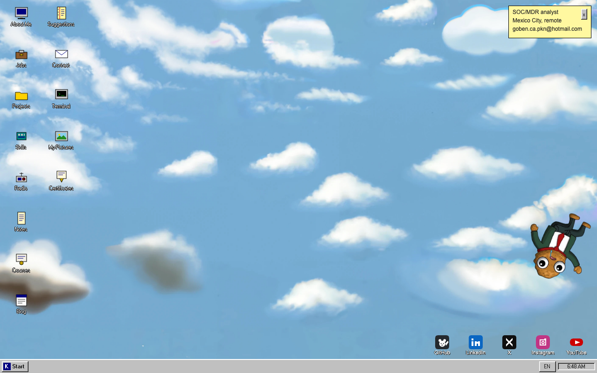
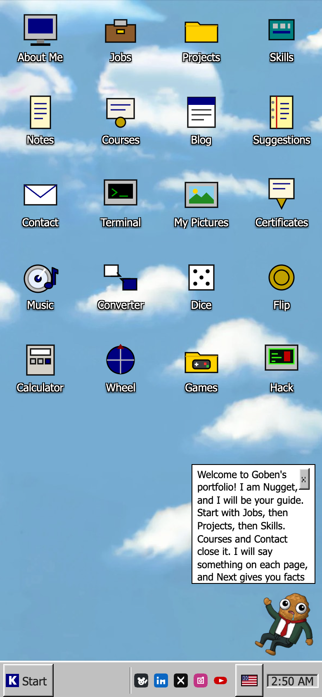
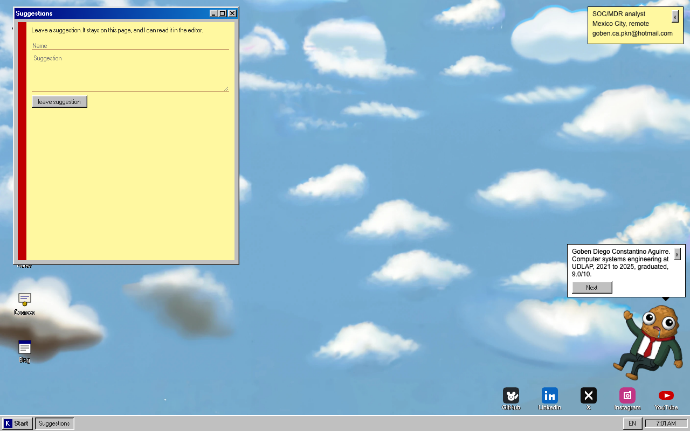
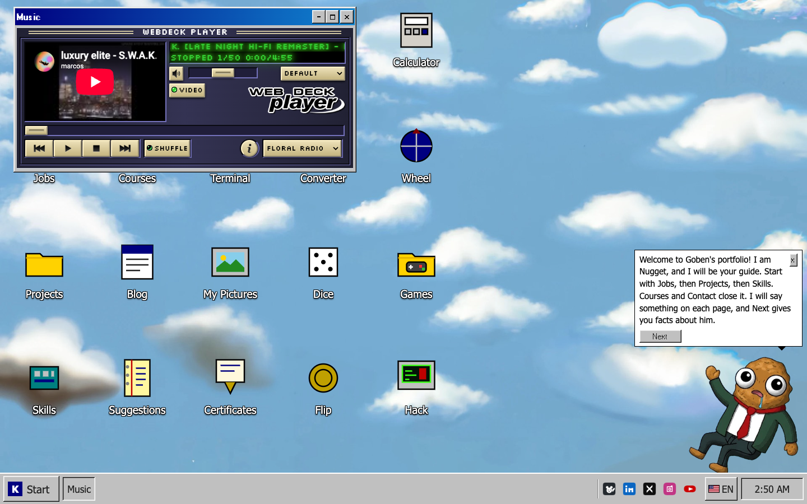
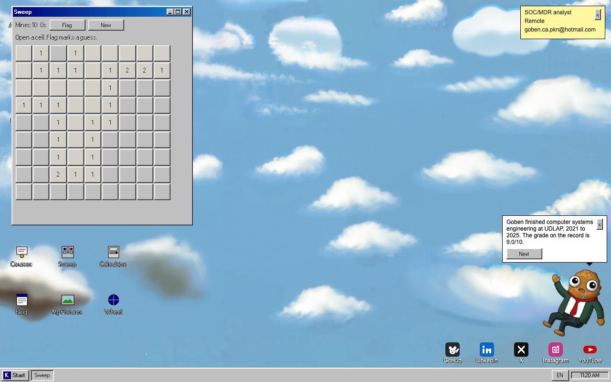

# PocketNugget 🖥️

[](https://www.typescriptlang.org/)
[](https://vite.dev/)
[](https://workers.cloudflare.com/)
[](https://developers.cloudflare.com/d1/)
[](https://vitest.dev/)
[](https://jdan.github.io/98.css/)
[](https://pocketnugget.xyz)

> Escritorio al estilo Windows 98 para el portafolio de Goben Diego Constantino Aguirre. TypeScript y Vite, servido por un Cloudflare Worker. Los posts y las sugerencias viven en D1. El sitio público está en inglés.

---

## 📋 Estado

El sitio que se publica es `site/`. El escritorio, el menú Start y la terminal no ofrecen el login. La entrada del editor es [`/login`](https://pocketnugget.xyz/login). El enlace viejo `/admin/login` abre esa misma página. El bloc público se llama Suggestions. Las writeups siguen en el icono Notes.

Hay un admin, usuario `goben`, con contraseña y un código de autenticador. La contraseña no está en el repo. Las direcciones de los visitantes no se guardan.

---

## 📸 Capturas

### Escritorio



### Teléfono



### Suggestions



### Player



### Sweep



Otras capturas pueden ir en `docs/screenshots/`. Basta el archivo y una línea en esta sección.

---

Portfolio for Goben Diego Constantino Aguirre (PocketNugget). English, static, and meant to run on Cloudflare Workers.

The page is a Windows 98 style desktop. Icons and the Start menu open the same pages. The Terminal window still runs the real commands, plus ASCII Snake and Tetris. Content lives in `site/src/catalog.ts` and `site/content/notes/`.

## Run

```bash
cd site
npm install
npm test
npm run dev
```

`npm run dev` is Vite. The Worker path, including security headers, `/.well-known/security.txt`, and `/build.json`, is:

```bash
cd site
npm run preview
```

That builds the client and starts `wrangler dev`. Refresh a project URL. It should still be that project.

`scripts/check.sh` from the repo root typechecks, runs the tests, builds, and greps the output for the defaults this site does not ship.

## Desktop

`npm run dev` copies 98.css and its pixel font into `site/public/vendor/` before Vite starts. Those files are committed too, with the CC BY-SA note for the font (Pixelated MS Sans Serif by lou, via Fontstruct).

Double-click a desktop icon, or use Start. Windows drag from the title bar, resize from the edges, and minimize, maximize, and close. Open windows sit on the taskbar. On a phone, a tap opens an icon and the window fills the screen.

Wallpaper files are `site/public/wallpapers/`. The default is `sky.jpg`. Display Properties (Start, then Display) switches Sky, Teal, Clouds, and Navy for the current tab. Icon positions after a drag are remembered the same way. Neither is a cookie.

To change a page, edit `site/src/catalog.ts`. The desktop apps are the list at the top of `site/src/desktop/desktop.ts`. Snake and Tetris live in `site/src/desktop/games.ts`. The Terminal commands `snake` and `tetris` still start them there. The Snake and Tetris icons open a terminal that is already in that game. Esc leaves it. Radio stays a text page at `/radio` and a terminal command. It is not a desktop icon and it is not in Start.

### Extra apps

Each of these is a normal window. Open it from the icon or from Start. The terminal names are in parentheses.

- Player (`player`). Webdeck Player v1.0.2, MIT, by Chris, hosted on this site under `site/public/vendor/webdeck-player/`. Opening the window loads Magic Ways, by Tatsuro Yamashita, in YouTube's own player. The list also has a mix that starts on that video, Floral Shoppe, by Macintosh Plus, a mix that starts on that track, and Permaculture, by MTHRBORD. This site does not host those files. Square-wave tones are gone from this window. The legal page says what is embedded and what is not.
- My Pictures (`pictures`) and Certificates (`awards`). Thumbnails, then a larger view with previous and next. The files live in `site/public/media/`. The titles and captions are `site/src/desktop/media.ts`. The public site cannot read a folder on your computer, so copy new photos into `public/media` and add a line to that file. The first set was copied from the local Desktop folder of photos and certificate scans.
- Converter (`encode`). Base64, hex, and URL encode and decode, text to binary, MD5, SHA-1, and SHA-256, plus KB, MB, and GB using 1024, not 1000. One MB is 1048576 bytes. It runs in the page. Nothing is uploaded.
- Sweep (`sweep`). A 9 by 9 grid with 10 mines. Click opens a cell. Right-click, or the Flag button, marks one. The first open cell is never a mine.
- Dice (`dice`). A die with 4, 6, 8, 10, 12, or 20 sides. Six is the default.
- Flip (`flip`). Heads or tails, with a short flip.
- Calculator (`math`). Left to right, the way the Windows 98 calculator did it. It does not use `eval`.
- Wheel (`wheel`). One name on each line, then a spin. The winner is written under the wheel.
- Facts (`facts`). Short lines from the same record as the catalog, plus buttons that open the other tools.
- Hack (`hack`). The window talks like a loud drop. The button throws an aggressive payload at the colors and labels on this page. Reset or Close puts the desktop back.
- Nugget (`buddy`). A floating assistant, not a window. Tips come from the same fact list. Close the balloon and the picture stays. Start has Show Nugget and Hide Nugget for this tab. The picture is `site/public/buddy/nugget.png`. Replace that file to change the character.
- Run and Find are in the Start menu. Find searches the profile text and opens the matching window.
- The taskbar EN button cycles English, Spanish, German, and French for this tab. Blog posts stay in the language they were written in.
- A yellow note shows the current role, place, and email. Closing it lasts for the tab.
- After a quiet minute and a half the picture bounces inside the sky and turns around when it hits an edge. A click or a key brings the desktop back. No sound. People who prefer less motion get a still picture.
- Licenses, marks, and the music player are on `/legal` (`legal` in the terminal, and in Start next to Colophon).
- Right-click the desktop for Arrange icons, Display, and Run.
- Print hides the taskbar and prints About, Jobs, and Projects.

Social icons sit on the wallpaper, in a row at the bottom right (a bar under the icons on a phone). They are PNGs in `site/public/social/`: `github.png`, `linkedin.png`, `x.png`, `instagram.png`, `youtube.png`. The addresses are the same ones as My Links. A click opens a new tab. To point one somewhere else, change the profile in `site/src/catalog.ts`. To redraw an icon, replace the PNG and keep the name.

## Deploy

`prod` is the only branch that publishes pocketnugget.xyz. A push there builds `site/` and deploys with the pinned Wrangler.

`test`, `main`, and any other branch run `npm test` in `site/`. They do not publish the site.

Do not run Wrangler from the repository root. A plain `wrangler deploy` from there can replace the Worker without its login secrets. From `site/`, after a Cloudflare account is already logged in:

```bash
cd site
./node_modules/.bin/wrangler deploy --keep-vars
```

The config is `site/wrangler.jsonc`. Compatibility date is 2026-05-03, the newest date Wrangler 4.86's local runtime accepts on Node 20. Static assets are the Vite `dist/` directory. The Worker runs first so it can set headers. Document routes return `index.html`. Unknown paths 404.

D1 database `pkn` is `d8bf9b4e-7a24-4f1f-997e-a47c99dd6f79` in `site/wrangler.jsonc`. Apply the schema to the remote database before the editor is used:

```bash
cd site
./node_modules/.bin/wrangler d1 migrations apply pkn --remote
```

The public host is `https://pocketnugget.xyz`. `robots.txt` points at that sitemap. The Worker builds `/sitemap.xml` from the request origin, so the apex and any `workers.dev` hostname stay consistent with the URL that was requested. `www` and `hackztecs` are tunnels and are not routes on this Worker.

Terraform for the DNS zone is a follow-up against the real zone. It is not in this repo. Docker and Cloudflare Tunnels stay on the homelab. This site does not need a cluster.

## Login and the blog

`links` is the public list (email, GitHub, LinkedIn, X, Instagram, YouTube). `blog` reads posts. `pad` opens Suggestions. The editor is not a desktop icon, a Start item, or a terminal command. Open `/login` in the address bar. `/admin/login` lands on that same form. A valid session opens `/admin`.

There is one admin, username `goben`. No public signup. The password is not in the repo. Login also asks for a 6 digit code from an authenticator app (TOTP, the same code Google Authenticator and Microsoft Authenticator show). It is not a Google or Microsoft login. The first successful password shows a QR once. After that code is accepted, later logins are password plus code. Eight recovery codes work in the code field, once each.

`node scripts/seed-auth.mjs` from `site/` writes a new password, the recovery codes, and the otpauth URI to `~/Downloads/pkn-admin-login.txt` and then deletes nothing by itself. Scan the file, then delete it. `--apply` also sets the Worker secrets and the D1 row. Do not commit that file.

The editor can change the password. The new hash is stored in D1 and wins over the Worker secret. Local Vite has no D1, so the login says it is not configured.

The session is an HttpOnly, SameSite=Strict cookie. The database stores a hash of that cookie, the posts, the encrypted authenticator secret, recovery-code hashes, and login-failure times. It does not store visitor addresses. A wrong password and a wrong username get the same answer. Eight failures in fifteen minutes lock the login, including bad codes. Mutations require the browser Origin.

## What the Worker stores

Blog posts, public suggestions, session hashes, the authenticator secret (encrypted), recovery-code hashes, and login-failure times, in D1. No contact form, no third-party script, no analytics table. The window font ships with 98.css in `site/public/vendor/`. `security.txt` points at `goben.ca.pkn@hotmail.com`.

## Legacy

`legacy/` is the old React, Deno, and SQLite app. Leave it there. See `legacy/README.md`.
