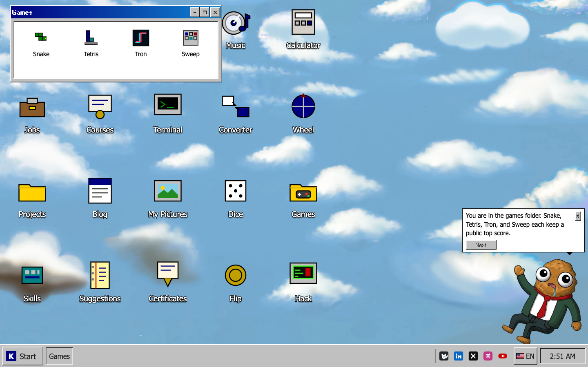
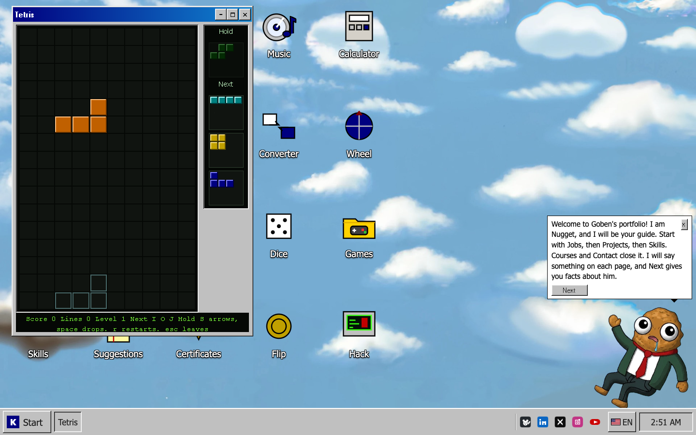
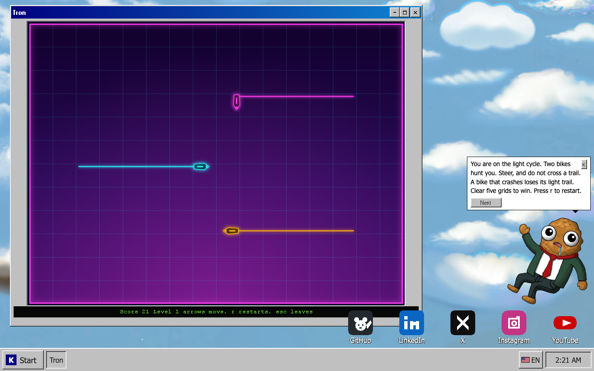

# PocketNugget 🖥️

[](https://www.typescriptlang.org/)
[](https://vite.dev/)
[](https://workers.cloudflare.com/)
[](https://developers.cloudflare.com/d1/)
[](https://vitest.dev/)
[](https://jdan.github.io/98.css/)
[](https://pocketnugget.xyz)

> Windows 98 style desktop for the portfolio of Goben Diego Constantino Aguirre. TypeScript and Vite, served by one Cloudflare Worker. D1 holds the posts, the suggestions, the score names, and the login state. The taskbar switches the public pages among English, Spanish, German, and French.

---

## 📋 Status

The published app is `site/`. The desktop, the Start menu, and the terminal do not offer login. The editor is [`/login`](https://pocketnugget.xyz/login). The old `/admin/login` link opens that same page. The public pad is called Suggestions. Writeups stay on the Notes icon.

There is one admin, username `goben`, with a password and an authenticator code. The password is not in the repo. Visitor addresses are not stored.

---

## 📸 Screenshots

### Desktop


### Phone


### Suggestions


### Player


### Games



### Tetris



### Tron



### Sweep


Other shots can go in `docs/screenshots/`. Add the file and one line in this section.

---

Portfolio for Goben Diego Constantino Aguirre (PocketNugget). It runs on Cloudflare Workers. The public pages are English, Spanish, German, and French.

The profile covers security operations (SOC/MDR), research, DevOps, and software development, and the pages say so. The page is a Windows 98 style desktop. Icons and the Start menu open the same pages. The Terminal window still runs the real commands. Snake, Tetris, and Tron are their own windows, with a public best score. Content lives in `site/src/catalog.ts` and `site/content/notes/`.

## Tech stack and how it was built

**Stack**

| Layer | What | Why |
|---|---|---|
| Client | TypeScript 7, Vite 8, no UI framework | The whole desktop is DOM built by hand. About 300 kB of JS, 100 kB gzipped, one CSS file |
| Look | 98.css 0.1.21 plus `styles.css` | Windows 98 window chrome from 98.css. The pixel face (Pixelated MS Sans Serif) is served from this site. Tahoma carries the reading text and the controls |
| Server | One Cloudflare Worker (`site/src/worker.ts`) | Sets the security headers, serves `security.txt` and `build.json`, answers `/api/*`, and returns `index.html` for document routes |
| Data | Cloudflare D1 (SQLite) | Blog posts, suggestions, game score names, session hashes, the encrypted TOTP secret, recovery-code hashes, login-failure times |
| Tests | Vitest 4 with happy-dom | 170 tests in 29 files, covering the API, markup, i18n, the desktop, the games, and the blog |
| Tooling | Wrangler 4, `scripts/check.sh` | One command typechecks, tests, builds, and greps the output for what the site does not ship |

The only runtime dependency is `98.css`. TypeScript, Vite, Vitest, Wrangler, and happy-dom are build and test tools.

**How it fits together**

1. `site/src/catalog.ts` holds the record: jobs, projects, the hero numbers, the profiles. `render.ts` turns it into the pages, and the same text feeds the terminal commands, the Facts window, the nugget, the printed CV, and the page metadata.
2. `site/src/desktop/desktop.ts` is the desktop: the app list, icon grid, windows (drag, resize, minimize, maximize), taskbar, Start menu, wallpaper, and the phone layout where a window fills the screen. Each app is a `mount...` function that returns `{ pause, resume, destroy }`.
3. Every text is a tuple in `i18n.ts` and `i18n-extra.ts`: English, Spanish, German, and French. A test fails when a new line is missing a language, and one more forbids long dashes, `ß`, and a banned percentage.
4. The Worker serves static files from `dist/` and runs first, so it can add headers. Routes that are pages return the same `index.html`, and the client picks the window from the URL.
5. The blog, comments, scores, and login are small JSON endpoints in `api.ts`. The editor is behind `/login`, a password plus a TOTP code. See "Login and the blog".

**The games**

- Snake and Tetris are DOM grids driven by pure state functions in `games.ts`, so the tests step them without a browser. Tetris deals pieces from a shuffled seven-piece bag, so the order changes every game. It shows the next three pieces and a Hold box (C, or the Hold button on a phone).
- Tron (`cycle.ts`, drawn by `cyclepaint.ts`) runs on a 64 by 48 grid with two enemies. One hunts you by aiming ahead of your bike. The other plays for open space. A crashed enemy loses its light trail. Clear five grids to win. The drawing is a canvas: glow lines for trails, a rotated light cycle for each bike, a synth backdrop with scan lines.
- Sweep grows tighter after each clear and keeps the score.
- Each game shows the public top scores inside its Play and Exit panel, with a name box when a round ends. Scores are capped per game on the server.

**Blog**

Posts are Markdown, rendered by `markup.ts` into a small whitelist of tags. It supports headings, bold, italic, links, numbered and bullet lists, quotes, rules, fenced code, and images from this site's own paths. `assertSafeHtml` re-checks the result on the server before a post is saved and in the browser before it is shown. The editor has a formatting toolbar and a live preview. The Blog icon wears a red bubble while a post from the last four months exists (`blog.ts`).

**Safari**

The page was tested in real WebKit through Playwright (iPhone 13, iPad Pro 11, and a desktop window) with no page errors. The things Safari needs are in place: `svh` heights with a plain fallback, `-webkit-user-select`, `-webkit-touch-callout` and tap-highlight resets, inputs at 16 px so iOS does not zoom, safe-area insets, and a canvas for Tron instead of three thousand DOM cells. The viewport key `interactive-widget` is ignored by Safari and only logs a console warning. `site/scripts/ui-audit.mjs` opens every window at ten sizes in Chromium, WebKit, and Firefox and fails on windows outside the desk, sideways overflow, clipped title bars, small tap targets, and axe WCAG 2.2 AA violations. Playwright is not a dependency of the site. See that file for the command.

**Performance**

The wallpaper is preloaded, window images load lazily, and the photo and icons are sized for their use. Lighthouse 12 on the home page: mobile performance 86, desktop 99, with accessibility, best practices, and SEO at 100.

**What it does not do**

No framework, no analytics, no third-party script, and no visitor addresses stored. The only cookie is the editor session, and only after login. Nothing here claims a skill the CV does not.

## Run

```bash
cd site
npm install
npm test
npm run dev
```

`npm run dev` is Vite. The Worker path, including security headers, `/.well-known/security.txt`, and `/build.json`, is:

```bash
cd site
npm run preview
```

That builds the client and starts `wrangler dev`. Refresh a project URL. It should still be that project.

`scripts/check.sh` from the repo root typechecks, runs the tests, builds, and greps the output for the defaults this site does not ship.

## Desktop

`npm run dev` copies 98.css and its pixel font into `site/public/vendor/` before Vite starts. Those files are committed too, with the CC BY-SA note for the font (Pixelated MS Sans Serif by lou, via Fontstruct).

Double-click a desktop icon, or use Start. Windows drag from the title bar, resize from the edges, and minimize, maximize, and close. Open windows sit on the taskbar. On a phone, a tap opens an icon and the window fills the screen.

Wallpaper files are `site/public/wallpapers/`. The default is `sky.jpg`. Display Properties (Start, then Display) switches Sky, Teal, Clouds, and Navy for the current tab. Icon positions after a drag are remembered the same way. Neither is a cookie.

To change a page, edit `site/src/catalog.ts`. The desktop apps are the list at the top of `site/src/desktop/desktop.ts`. Snake and Tetris live in `site/src/desktop/games.ts`. Tron, the light cycle, lives in `site/src/desktop/cycle.ts`. The Terminal commands `snake`, `tetris`, and `tron` start them there. Those icons open a window that is already in that game. The level rises while the round lasts. Again, or the R key, starts the round over, and a name can be saved on the public score list. Esc leaves it. Radio stays a text page at `/radio` and a terminal command. It is not a desktop icon and it is not in Start.

### Extra apps

Each of these is a normal window. Open it from the icon or from Start. The terminal names are in parentheses.

- Music (`player`, the Player window). Webdeck Player v1.0.2, MIT, by Chris, hosted on this site under `site/public/vendor/webdeck-player/`. The window opens on Floral Radio, played in YouTube's own player. The theme is Silver in Safari and the default theme in Chrome based browsers and the rest. The list also has Floral Shoppe, by Macintosh Plus, Magic Ways, by Tatsuro Yamashita, a mix that starts on that video, and Permaculture, by MTHRBORD. This site does not host those files. Square-wave tones are gone from this window. The legal page says what is embedded and what is not.
- My Pictures (`pictures`) and Certificates (`awards`). Thumbnails, then a larger view with previous and next. The files live in `site/public/media/`. The titles and captions are `site/src/desktop/media.ts`. The public site cannot read a folder on your computer, so copy new photos into `public/media` and add a line to that file. The first set was copied from the local Desktop folder of photos and certificate scans.
- Converter (`encode`). Base64, hex, and URL encode and decode, text to binary, MD5, SHA-1, and SHA-256, plus KB, MB, and GB using 1024, not 1000. One MB is 1048576 bytes. It runs in the page. Nothing is uploaded.
- Sweep (`sweep`). It starts as a 9 by 9 grid with 10 mines. A clear opens a tighter grid and keeps the score. Click opens a cell. Right-click, or the Flag button, marks one. The first open cell is never a mine. Again starts over. A name can be saved on the public score list.
- Dice (`dice`). A die with 4, 6, 8, 10, 12, or 20 sides. Six is the default.
- Flip (`flip`). Heads or tails, with a short flip.
- Calculator (`math`). Left to right, the way the Windows 98 calculator did it. It does not use `eval`.
- Wheel (`wheel`). One name on each line, then a spin. The winner is written under the wheel and taken off the list, so the next spin starts without them.
- Facts (`facts`). Short lines from the same record as the catalog, plus buttons that open the other tools.
- Hack (`hack`). The window talks like a loud drop. A warning for people with photosensitive epilepsy sits above the button. The button throws an aggressive payload at the colors and labels on this page, and the nugget reacts. Reset or Close puts the desktop back.
- Nugget (`buddy`). A floating guide, not a window. It welcomes the visitor, says something on each page, and Next gives more facts from the same list. On a phone the balloon closes by itself after a few seconds, and a tap on the picture opens it again. Close the balloon and the picture stays. Start has Show Nugget and Hide Nugget for this tab. The picture is `site/public/buddy/nugget.png`. Replace that file to change the character.
- Run and Find are in the Start menu. Find searches the profile text and opens the matching window.
- The taskbar EN button cycles English, Spanish, German, and French for this tab. Blog posts stay in the language they were written in.
- A yellow note shows the current role, place, and email. Closing it lasts for the tab.
- After a quiet minute and a half the picture bounces inside the sky and turns around when it hits an edge. A click or a key brings the desktop back. No sound. People who prefer less motion get a still picture.
- Licenses, marks, and the music player are on `/legal` (`legal` in the terminal, and in Start next to Colophon).
- Right-click the desktop for Arrange icons, Display, and Run.
- Print hides the taskbar and prints About, Jobs, and Projects.

Social icons sit in the taskbar tray, small like the Windows notification icons, between the window buttons and the language button. Each one shows its name as a tooltip on hover or focus and is named for screen readers. They are PNGs in `site/public/social/`: `github.png`, `linkedin.png`, `x.png`, `instagram.png`, `youtube.png`. The addresses are the same ones as My Links. A click opens a new tab. To point one somewhere else, change the profile in `site/src/catalog.ts`. To redraw an icon, replace the PNG and keep the name.

## Deploy

`prod` is the only branch that publishes pocketnugget.xyz. A push there builds `site/` and deploys with the pinned Wrangler.

`test`, `main`, and any other branch run `npm test` in `site/`. They do not publish the site.

Do not run Wrangler from the repository root. A plain `wrangler deploy` from there can replace the Worker without its login secrets. From `site/`, after a Cloudflare account is already logged in:

```bash
cd site
./node_modules/.bin/wrangler deploy --keep-vars
```

The config is `site/wrangler.jsonc`. Compatibility date is 2026-05-03, the newest date Wrangler 4.86's local runtime accepts on Node 20. Static assets are the Vite `dist/` directory. The Worker runs first so it can set headers. Document routes return `index.html`. Unknown paths 404.

D1 database `pkn` is bound in `site/wrangler.jsonc`. Apply the schema to the remote database before the editor is used:

```bash
cd site
./node_modules/.bin/wrangler d1 migrations apply pkn --remote
```

The public host is `https://pocketnugget.xyz`. `robots.txt` points at that sitemap. The Worker builds `/sitemap.xml` from the request origin, so the apex and any `workers.dev` hostname stay consistent with the URL that was requested. `www` and `hackztecs` are tunnels and are not routes on this Worker.

Terraform for the DNS zone is a follow-up against the real zone. It is not in this repo. Docker and Cloudflare Tunnels stay on the homelab. This site does not need a cluster.

## Login and the blog

`links` is the public list (email, GitHub, LinkedIn, X, Instagram, YouTube). `blog` reads posts. `pad` opens Suggestions, the site's feedback box, with a Leave some feedback!! button. The editor is not a desktop icon, a Start item, or a terminal command. Open `/login` in the address bar. `/admin/login` lands on that same form. A valid session opens `/admin`.

There is one admin, username `goben`. No public signup. The password is not in the repo. Login also asks for a 6 digit code from an authenticator app (TOTP, the same code Google Authenticator and Microsoft Authenticator show). It is not a Google or Microsoft login. The first successful password shows a QR once. After that code is accepted, later logins are password plus code. Eight recovery codes work in the code field, once each.

`node scripts/seed-auth.mjs` from `site/` writes a new password, the recovery codes, and the otpauth URI to `~/Downloads/pkn-admin-login.txt` and then deletes nothing by itself. Scan the file, then delete it. `--apply` also sets the Worker secrets and the D1 row. Do not commit that file.

The editor can change the password. The new hash is stored in D1 and wins over the Worker secret. Local Vite has no D1, so the login says it is not configured.

The session is an HttpOnly, SameSite=Strict cookie. The database stores a hash of that cookie, the posts, the encrypted authenticator secret, recovery-code hashes, and login-failure times. It does not store visitor addresses. A wrong password and a wrong username get the same answer. Eight failures in fifteen minutes lock the login, including bad codes. Mutations require the browser Origin.

## What the Worker stores

Blog posts, public comments, contact messages, session hashes, the authenticator secret (encrypted), recovery-code hashes, and login-failure times, in D1. The contact form writes to D1 and nothing leaves it. No third-party script, no analytics table. The window font ships with 98.css in `site/public/vendor/`. `security.txt` points at `goben.ca.pkn@hotmail.com`.

## Legacy

`legacy/` is the old React, Deno, and SQLite app. Leave it there. See `legacy/README.md`.
